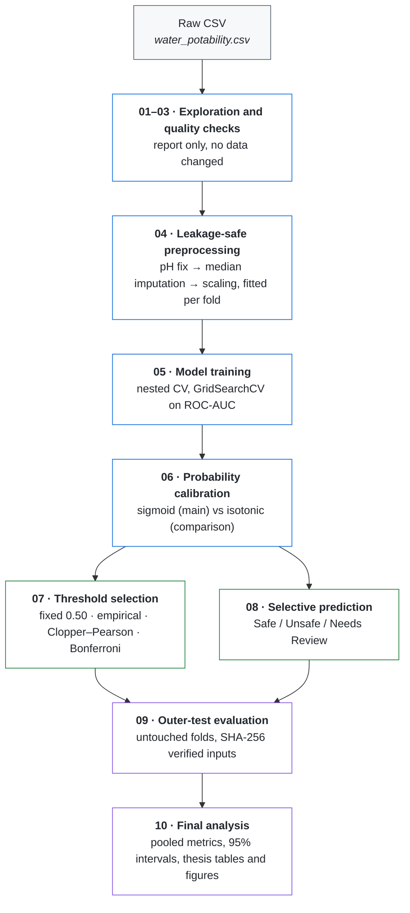
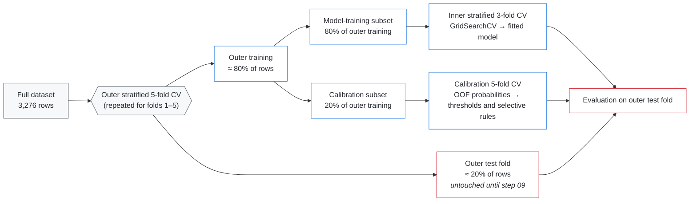
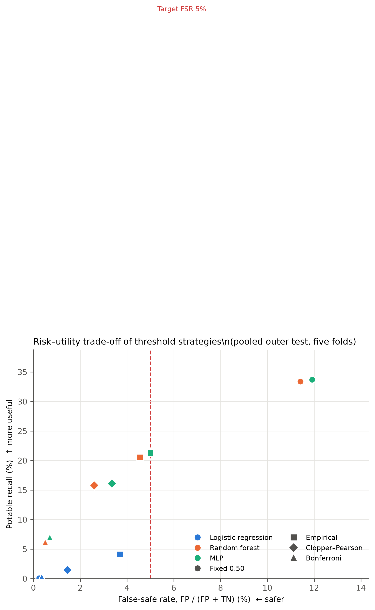

# Evaluating Risk-Aware and Selective Machine Learning for Water Potability Classification

**Risk-Constrained Water Potability Classification: calibrated models, risk-controlled thresholds and selective prediction**

BSc thesis workspace by **Anisur Rahman**

<p align="center">
  
</p>

---

**Key findings** (pooled outer test, five folds, n = 3,276)

- At the conventional 0.50 threshold, random forest declares **11.4%** of non-potable samples safe; a Clopper–Pearson threshold lowers this to **2.6%** and meets the 5% target in all five folds.
- Random forest and MLP reach ROC-AUC **0.685** and **0.684** (overlapping intervals); logistic regression does not rank better than chance (0.485).
- Abstaining on about 26% of samples keeps FSR under 5% (RF 4.5%, MLP 4.9%) with potable recall of about 21%.
- Sigmoid calibration reduces random-forest ECE from 0.057 to 0.024 without changing ranking ability.

---

## Table of contents

1. [Overview](#1-overview)
2. [Research aim, objectives and questions](#2-research-aim-objectives-and-questions)
3. [Dataset](#3-dataset)
4. [Repository structure](#4-repository-structure)
5. [Methodology](#5-methodology)
6. [Experimental design](#6-experimental-design)
7. [Key results](#7-key-results)
8. [Installation](#8-installation)
9. [Reproducing the experiments](#9-reproducing-the-experiments)
10. [Limitations](#10-limitations)
11. [Citation and acknowledgements](#11-citation-and-acknowledgements)

---

## 1. Overview

Most published work on water potability prediction reports accuracy or ROC-AUC at a fixed 0.50 decision threshold. In a drinking-water setting those numbers hide the error that matters most: **declaring non-potable water safe**.

This thesis treats that error as the primary risk and asks how far it can be controlled. The workflow:

- trains three classifiers (logistic regression, random forest, MLP) and a majority-class reference under **nested, stratified 5-fold cross-validation**;
- **calibrates** predicted probabilities with sigmoid (Platt) scaling;
- chooses decision thresholds that keep the **False-Safe Rate (FSR)** at or below a 5% target, using empirical, **Clopper–Pearson** and **Bonferroni-corrected** rules;
- adds **selective prediction**, where uncertain samples are routed to *Needs Review* instead of being forced into a decision;
- evaluates everything once, on **untouched outer-test folds**, with exact and bootstrap 95% intervals.

### Primary risk metric

| Term | Definition |
| --- | --- |
| Positive class | `1` = Potable (water declared **safe**) |
| False-safe error | actual non-potable (`0`) predicted potable (`1`) |
| **False-Safe Rate (FSR)** | **FP / (FP + TN)**, the share of all non-potable samples that were declared safe |
| Supplementary metric | FP / (TP + FP), the unsafe share among samples declared safe |
| Target | FSR ≤ **5%** (sensitivity targets: 10%, 20%, 30%) |

---

## 2. Research aim, objectives and questions

### Aim

To assess how risk-constrained threshold selection and selective prediction change error profiles and decision coverage for machine-learning-based water potability classification on a public labelled dataset.

### Objectives

1. Build reproducible baseline models using logistic regression, random forest and an MLP neural network, with a majority-class reference.
2. Compare a fixed 0.50 threshold, an empirically selected threshold, and confidence-bound thresholds with correction for multiple threshold tests.
3. Evaluate selective prediction (abstention) at several decision-coverage targets and report the resulting review workload.
4. Report every result on untouched outer-test folds with leakage-safe preprocessing and verifiable artifacts.

### Research questions

| ID | Research question |
| --- | --- |
| **RQ1** | How do fixed, empirical and corrected thresholds differ in false-safe rate and potable recall under a shared test definition? |
| **RQ2** | At different decision-coverage targets, how does abstention change accepted error and review workload? |
| **RQ3** | Are the risk–utility trade-offs consistent across model types and stratified test folds? |
| **RQ4** | How does probability calibration affect probability quality and risk-controlled classification decisions? |

---

## 3. Dataset

| Property | Value |
| --- | --- |
| Source | [Water Potability dataset, Kaggle](https://www.kaggle.com/datasets/adityakadiwal/water-potability) |
| File | `01_Data/raw/water_potability.csv` |
| Rows × columns | 3,276 × 10 (9 numeric features + 1 binary target) |
| Target | `Potability` (0 = non-potable, 1 = potable) |
| Class balance | 1,998 non-potable (61.0%) · 1,278 potable (39.0%) |
| Duplicate rows | 0 |

**Features:** `ph`, `Hardness`, `Solids`, `Chloramines`, `Sulfate`, `Conductivity`, `Organic_carbon`, `Trihalomethanes`, `Turbidity`

### Data quality

| Feature | Missing | Missing % | Note |
| --- | ---: | ---: | --- |
| Sulfate | 781 | 23.84% | median-imputed inside each training fold |
| ph | 491 | 14.99% | one physically invalid value (pH = 0) treated as missing |
| Trihalomethanes | 162 | 4.95% | median-imputed inside each training fold |
| Other 6 features | 0 | 0.00% | — |

IQR screening flags 0.3–2.5% of values per feature as outliers. They are **kept**, not removed or capped, because they fall within plausible measurement ranges and removing them would alter the test distribution.

---

## 4. Repository structure

```text
Water_Potability_Thesis_Workspace/
│
├── 01_Data/
│   ├── raw/                      # Original Kaggle CSV (never modified)
│   └── processed/                # Early exploratory 80/20 split (see note below)
│
├── 02_Code/                      # Numbered pipeline scripts (run in order)
│   ├── 01_data_exploration.py
│   ├── 02_data_visualization.py
│   ├── 03_data_quality_checks.py
│   ├── 04_data_preprocessing.py
│   ├── 05_model_training.py
│   ├── 06_probability_calibration.py
│   ├── 07_threshold_selection.py
│   ├── 08_selective_prediction.py
│   ├── 09_model_evaluation.py
│   ├── 10_final_results_analysis.py
│   └── water_utils.py            # fix_invalid_ph() used inside saved pipelines
│
├── 03_Experiments/
│   └── fold_1 … fold_5/
│       ├── models/               # Fitted pipelines (.joblib), one per model
│       ├── calibrators/          # Sigmoid and isotonic calibrators (.joblib)
│       ├── split_manifest.json   # Exact row indices for train / calibration / test
│       ├── thresholds.json       # Thresholds selected on calibration data
│       ├── selective_rules.json  # Confidence cut-offs for abstention
│       ├── selective_manifest.json
│       └── evaluation_manifest.json  # SHA-256 fingerprints of all inputs
│
├── 04_Results/
│   ├── figures/                  # ROC, reliability, confusion matrices, trade-off plots (PNG + PDF)
│   └── tables/                   # Per-fold and pooled CSV results, final report (10_final_results_report.md)
│
├── 05_Notes/                     # Research and methodology notes
├── 06_Documentation/             # Project documentation
│
├── .gitignore
├── README.md
└── requirements.txt
```

> The local virtual environment (`.venv/`), `__pycache__/` and temporary files are excluded through `.gitignore`.

**About `01_Data/processed/`:** these CSV files (`train_clean`, `test_clean`, `train_scaled`, `test_scaled`) and `preprocessing_params.json` come from an early exploratory single 80/20 split. They are **not** used by the final pipeline. Scripts 05–09 read only the raw CSV and perform all imputation and scaling inside each fold's scikit-learn pipeline, so no preprocessing statistic is shared across folds.

---

## 5. Methodology



### 5.1 Preprocessing (leakage-safe)

All preprocessing lives **inside scikit-learn pipelines**, so every statistic is learned only from the training portion of each fold.

| Step | Logistic regression, MLP | Random forest, majority baseline |
| --- | --- | --- |
| Invalid pH (≤ 0 or > 14) → missing | ✓ (`fix_invalid_ph`) | ✓ |
| Median imputation | ✓ | ✓ |
| Standard scaling | ✓ | — (not needed for trees) |

### 5.2 Models and hyperparameter search

Hyperparameters are tuned with `GridSearchCV` (stratified 3-fold inner CV, scoring = ROC-AUC, `random_state = 42`).

<details>
<summary>Hyperparameter search space</summary>

<br>

| Model | Search space |
| --- | --- |
| Majority baseline | `DummyClassifier(strategy="prior")`, reference only, never ranked |
| Logistic regression | `C ∈ {0.01, 0.1, 1, 10}`, `class_weight ∈ {None, balanced}` |
| Random forest | 300 trees; `max_depth ∈ {None, 10, 20}`, `min_samples_leaf ∈ {1, 5}`, `max_features ∈ {sqrt, 0.5}`, `class_weight ∈ {None, balanced}` |
| MLP | `hidden_layer_sizes ∈ {(32,), (64,), (64, 32)}`, `alpha ∈ {1e-4, 1e-3, 1e-2}`, `learning_rate_init ∈ {1e-3, 1e-2}`, early stopping |

</details>

### 5.3 Probability calibration

- **Main method:** sigmoid (Platt) calibration on the logit of the model probability.
- **Comparison:** isotonic regression.
- Calibrators are compared with stratified 5-fold CV **inside** the calibration subset, using out-of-fold (OOF) predictions; metrics are Brier score, log loss and ECE (10 equal-width bins).
- OOF sigmoid probabilities feed threshold and selective-rule selection. A full-fit calibrator, trained on the whole calibration subset, is applied only to the outer-test fold.

### 5.4 Risk-constrained threshold selection

Candidate family: 201 cut-offs from 0.000 to 1.000 in steps of 0.005, plus one reject-all cut-off (202 in total). The lowest threshold satisfying each rule is selected on calibration data only.

| Strategy | Rule |
| --- | --- |
| Fixed 0.50 | Conventional reference, no risk constraint |
| Empirical | Observed FSR ≤ 5% |
| Clopper–Pearson | One-sided exact 95% upper bound on FSR ≤ 5% |
| Bonferroni | Clopper–Pearson bound at α / 202, correcting for the whole threshold family |

If no candidate satisfies a bound-based rule, the conservative reject-all cut-off is stored and flagged as infeasible.

### 5.5 Selective prediction (abstention)

- Confidence = `|p − 0.5|` from the calibrated OOF probability.
- Target decision coverages: **25%, 50%, 75%, 100%**; the cut-off keeps the most confident share of calibration rows.
- Rows above the cut-off are decided (`p ≥ 0.5` → Safe, otherwise Unsafe); the rest go to **Needs Review**.
- Recall is reported over **all** rows, so abstained potable samples count as missed, and review workload is always reported next to error.

### 5.6 Evaluation and statistical reporting

- Metrics: ROC-AUC, average precision, Brier score, log loss, ECE, FSR, potable recall, precision, F1, coverage, accepted error and review share.
- Results are reported **pooled** across the five outer-test folds (n = 3,276) and as **fold mean ± SD**.
- 95% intervals: stratified bootstrap for ROC-AUC and Brier (2,000 resamples, seed 42); exact Clopper–Pearson for FSR and recall.
- `folds_meeting_target_fsr` shows how many of the five folds individually met the 5% target.

---

## 6. Experimental design

| Level | Design | Purpose |
| --- | --- | --- |
| Outer loop | Stratified 5-fold CV (shuffle, seed 42) | Untouched test folds for final evaluation |
| Outer training split | 80% model-training / 20% calibration (stratified) | Separates fitting from calibration and threshold choice |
| Inner loop | Stratified 3-fold CV + `GridSearchCV` | Hyperparameter tuning on model-training data only |
| Calibration CV | Stratified 5-fold inside the calibration subset | OOF probabilities for unbiased threshold selection |



**Safeguards against leakage and silent changes**

- Each outer-test fold is used **once**, only in `09_model_evaluation.py`; no model, threshold or cut-off is changed after seeing test results.
- `split_manifest.json` records the exact row indices of every split, and the five test folds are checked to cover every row exactly once.
- SHA-256 fingerprints of models, calibrators, thresholds and rules are written to manifests and re-verified before evaluation.
- A fixed random seed (42) is used throughout.

---

## 7. Key results

All numbers are pooled over the five untouched outer-test folds (n = 3,276) of the final five-fold run. Source: `04_Results/tables/10_final_results_report.md` and the `10_*.csv` tables in `04_Results/tables/`.

### 7.1 Probability quality (sigmoid-calibrated)

| Model | ROC-AUC [95% CI] | Average precision | Brier [95% CI] | ECE |
| --- | --- | ---: | --- | ---: |
| Majority baseline | 0.500 [0.482, 0.518] | 0.390 | 0.238 [0.238, 0.238] | 0.000 |
| Logistic regression | 0.485 [0.465, 0.505] | 0.387 | 0.239 [0.238, 0.240] | 0.016 |
| **Random forest** | **0.685 [0.666, 0.703]** | **0.604** | **0.211 [0.207, 0.216]** | 0.024 |
| MLP | 0.684 [0.666, 0.703] | 0.599 | 0.212 [0.207, 0.217] | **0.017** |

Random forest and MLP are practically tied (overlapping intervals). Logistic regression does not rank better than chance, which is consistent with the weak linear relationships in this dataset.

### 7.2 Threshold strategies (RQ1)

<p align="center">
  
</p>

<details>
<summary>Threshold results by model and strategy</summary>

<br>

| Model | Strategy | Mean threshold | FSR [95% CI] | Folds meeting 5% | Potable recall |
| --- | --- | ---: | --- | :---: | ---: |
| Random forest | Fixed 0.50 | 0.500 | 11.4% [10.1, 12.9] | 1 / 5 | 33.4% |
| Random forest | Empirical | 0.580 | 4.6% [3.7, 5.6] | 3 / 5 | 20.6% |
| Random forest | Clopper–Pearson | 0.624 | 2.6% [1.9, 3.4] | 5 / 5 | 15.8% |
| Random forest | Bonferroni | 0.743 | 0.5% [0.2, 0.9] | 5 / 5 | 6.2% |
| MLP | Fixed 0.50 | 0.500 | 11.9% [10.5, 13.4] | 0 / 5 | 33.7% |
| MLP | Empirical | 0.589 | 5.0% [4.1, 6.1] | 3 / 5 | 21.3% |
| MLP | Clopper–Pearson | 0.651 | 3.4% [2.6, 4.2] | 4 / 5 | 16.1% |
| MLP | Bonferroni | 0.785 | 0.7% [0.4, 1.2] | 5 / 5 | 7.0% |

</details>

**Finding:** the conventional 0.50 threshold lets about 11–12% of non-potable samples through as safe. Confidence-bound rules bring FSR well under 5% and meet the target in every fold (Clopper–Pearson for RF, Bonferroni for both), at a clear cost in potable recall.

### 7.3 Selective prediction (RQ2)

<details>
<summary>Selective prediction results by coverage target</summary>

<br>

| Model | Target coverage | Actual coverage | Review share | FSR [95% CI] | Potable recall (all rows) |
| --- | ---: | ---: | ---: | --- | ---: |
| Random forest | 25% | 23.3% | 76.7% | 0.7% [0.4, 1.1] | 7.1% |
| Random forest | 50% | 50.1% | 49.9% | 1.7% [1.1, 2.3] | 13.6% |
| Random forest | 75% | 74.0% | 26.0% | 4.5% [3.6, 5.5] | 20.6% |
| Random forest | 100% | 100.0% | 0.0% | 11.4% [10.1, 12.9] | 33.4% |
| MLP | 25% | 24.5% | 75.5% | 1.2% [0.7, 1.7] | 9.6% |
| MLP | 50% | 49.7% | 50.3% | 3.0% [2.3, 3.9] | 15.5% |
| MLP | 75% | 73.8% | 26.2% | 4.9% [4.0, 6.0] | 21.2% |
| MLP | 100% | 100.0% | 0.0% | 11.9% [10.5, 13.4] | 33.7% |

</details>

**Finding:** abstaining on the least confident ~25% of samples brings pooled FSR under the 5% target for both models while keeping roughly the same recall as the empirical threshold; lower coverage reduces risk further but sends most samples to manual review.

### 7.4 Overall picture and calibration (RQ3, RQ4)

- **Random forest** meets the 5% pooled FSR target with all three risk-controlled threshold strategies (empirical, Clopper–Pearson, Bonferroni); **MLP** meets it with Clopper–Pearson and Bonferroni (its empirical FSR is 5.01%). Their ROC-AUC intervals overlap, so they are practically tied.
- **Logistic regression** fails the discrimination gate. Its low FSR comes from declaring almost nothing potable (recall ≤ 4.1%), not from useful predictions.
- **Calibration (RQ4):** on the outer test, sigmoid calibration had a lower Brier score than isotonic regression for every learned model (RF 0.211 vs 0.212, MLP 0.212 vs 0.217). It reduced ECE from 0.057 to 0.024 for random forest and from 0.030 to 0.017 for MLP, while ROC-AUC stayed almost unchanged (RF 0.681 → 0.685, MLP 0.683 → 0.684). Calibration therefore mainly improves the reliability of the probabilities that the thresholds and abstention rules are applied to.
- Pooled FSR ≤ 5% does not guarantee every fold met 5%; per-fold counts are reported alongside every pooled figure.

**Most useful operating points meeting the 5% target**

| Model | Approach | FSR | Potable recall | Decision coverage |
| --- | --- | ---: | ---: | ---: |
| MLP | Selective, 75% target | 4.9% | 21.2% | 74% |
| Random forest | Selective, 75% target | 4.5% | 20.6% | 74% |
| Random forest | Empirical threshold | 4.6% | 20.6% | 100% |
| Random forest | Clopper–Pearson threshold (upper CI also ≤ 5%) | 2.6% | 15.8% | 100% |

---

## 8. Installation

**Requirements:** Python 3.10 or newer.

```bash
# 1. Clone the repository
git clone https://github.com/Ar-5060/water-quality-indexing-thesis.git

# 2. Go to the repository folder
cd water-quality-indexing-thesis

# 3. Go to the thesis workspace
cd Water_Potability_Thesis_Workspace

# 4. Create and activate a virtual environment
python -m venv .venv

# Windows
.venv\Scripts\activate
# macOS / Linux
source .venv/bin/activate

# 5. Install dependencies
pip install --upgrade pip
pip install -r requirements.txt
```

> The saved `.joblib` models must be loaded with the same scikit-learn version that created them. Use the pinned versions in `requirements.txt`.

---

## 9. Reproducing the experiments

Run every script from the **project root**, in this order:

| Step | Script | What it does | Main outputs |
| :---: | --- | --- | --- |
| 1 | `01_data_exploration.py` | Shape, types, missing values, class balance, summary statistics | console report |
| 2 | `02_data_visualization.py` | Distributions and correlation plots | `04_Results/figures/` |
| 3 | `03_data_quality_checks.py` | Missing, zero, negative, range and IQR outlier checks | `data_quality_report.csv` |
| 4 | `04_data_preprocessing.py` | Builds and validates the leakage-safe preprocessing pipelines | `preprocessing_report.csv` |
| 5 | `05_model_training.py --all` | Nested CV training and tuning for all models and folds | `03_Experiments/fold_k/models/`, `split_manifest.json` |
| 6 | `06_probability_calibration.py --all` | Sigmoid vs isotonic calibration, OOF probabilities | `calibrators/`, `calibrated_predictions_fold_k.csv` |
| 7 | `07_threshold_selection.py --all` | FSR-constrained threshold selection | `thresholds.json`, `threshold_selection_*.csv` |
| 8 | `08_selective_prediction.py --all` | Confidence cut-offs for abstention | `selective_rules.json`, `selective_prediction_*.csv` |
| 9 | `09_model_evaluation.py --all` | One-time evaluation on untouched outer-test folds | `evaluation_*.csv`, ROC / reliability / confusion figures |
| 10 | `10_final_results_analysis.py` | Pooled metrics, 95% intervals, thesis tables and figures | `10_*.csv`, `10_final_results_report.md` |

```bash
python 02_Code/01_data_exploration.py
python 02_Code/02_data_visualization.py
python 02_Code/03_data_quality_checks.py
python 02_Code/04_data_preprocessing.py
python 02_Code/05_model_training.py --all
python 02_Code/06_probability_calibration.py --all
python 02_Code/07_threshold_selection.py --all
python 02_Code/08_selective_prediction.py --all
python 02_Code/09_model_evaluation.py --all
python 02_Code/10_final_results_analysis.py
```

Scripts 05–09 also accept `--fold k` (k = 1…5) to run a single outer fold.

**Reproducibility notes**

- All randomness uses `random_state = 42`.
- Committed artifacts in `03_Experiments/` let steps 9–10 be re-run without retraining.
- `09_model_evaluation.py` stops if any SHA-256 fingerprint of a model, calibrator, threshold file or selective rule has changed.
- `10_final_results_analysis.py` will not overwrite existing outputs unless `--overwrite` is passed.

---

## 10. Limitations

- A single public dataset with weak feature–target signal; the best ROC-AUC is about 0.685.
- No external or temporally independent validation set.
- Confidence intervals are descriptive and conditional on pooled out-of-fold predictions; they are not formal paired model-comparison tests.
- Bonferroni correction covers the threshold family within each model, not all models simultaneously.
- A calibration-side FSR guarantee assumes exchangeability between calibration data and future samples.
- Results support decision-making research and are **not** a substitute for laboratory water testing.

---

## 11. Citation and acknowledgements

**Dataset:** Kadiwal, A. *Water Potability* [Data set]. Kaggle. https://www.kaggle.com/datasets/adityakadiwal/water-potability

**Methodological foundations**

- Platt, J. (1999). Probabilistic outputs for support vector machines and comparisons to regularized likelihood methods.
- Guo, C., Pleiss, G., Sun, Y., & Weinberger, K. Q. (2017). On calibration of modern neural networks. *ICML*.
- Geifman, Y., & El-Yaniv, R. (2017). Selective classification for deep neural networks. *NeurIPS*.
- Bates, S., Angelopoulos, A., Lei, L., Malik, J., & Jordan, M. I. (2021). Distribution-free, risk-controlling prediction sets. *Journal of the ACM*.
- Angelopoulos, A. N., Bates, S., Candès, E. J., Jordan, M. I., & Lei, L. (2022). Learn then test: Calibrating predictive algorithms to achieve risk control.
- Clopper, C. J., & Pearson, E. S. (1934). The use of confidence or fiducial limits illustrated in the case of the binomial. *Biometrika*.

**Author:** Anisur Rahman

---

*This repository is part of an ongoing BSc thesis. Results and text may change before final submission.*
